# Physical acceptance evidence — 2026-11-05

Normal visible Windows gameplay on the larger left DISPLAY1. The latest user
green light resumed the previously withheld controls. All game windows created
for these tests were closed; no commit/push was requested.

- [Structured receipt](receipt.json) distinguishes completed cases and limitations.
- [Input trace](input-trace.json) records actions in their original order.
- [Preservation](preservation.json) compares eight existing saves, designer terrain
  revision9 and the accepted world atlas against pre-test hashes.
- [Report/reload facts](campaign-report-reload.json) retain the one-time reward
  and exact disk reload proof without duplicating the large geography payload.
- `verification.json` is the final automated source receipt; failed and interim
  reports are retained under separate names. Automated interactive status is
  separate from the physical evidence here.
- `files.sha256.json` inventories the retained evidence bytes.

## Actual campaign mine contract

Fresh20261107 / Marches / Large. Managed preparation, ordinary round3 victory
(Bran12/14, Torin4/10), reward, exit, mine restoration, return, one-time report and
reload. Every enemy turn used AI, without Debug Win or state injection.

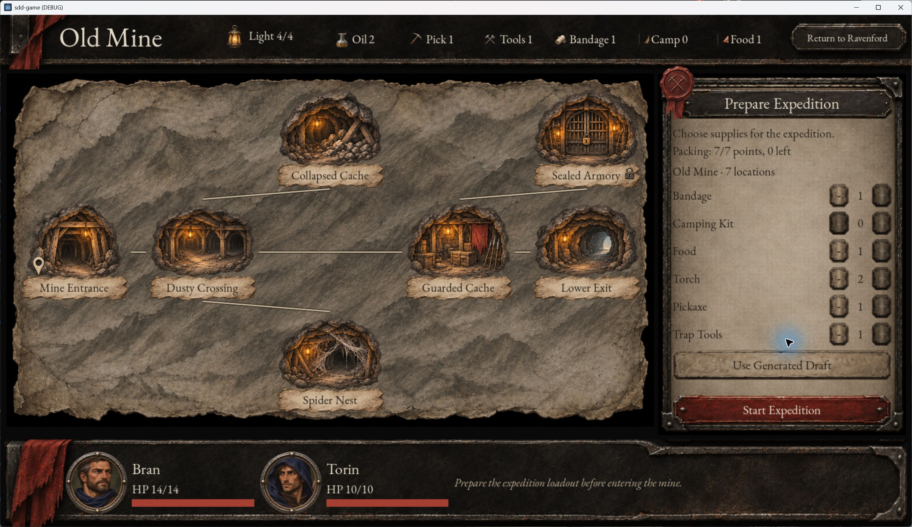
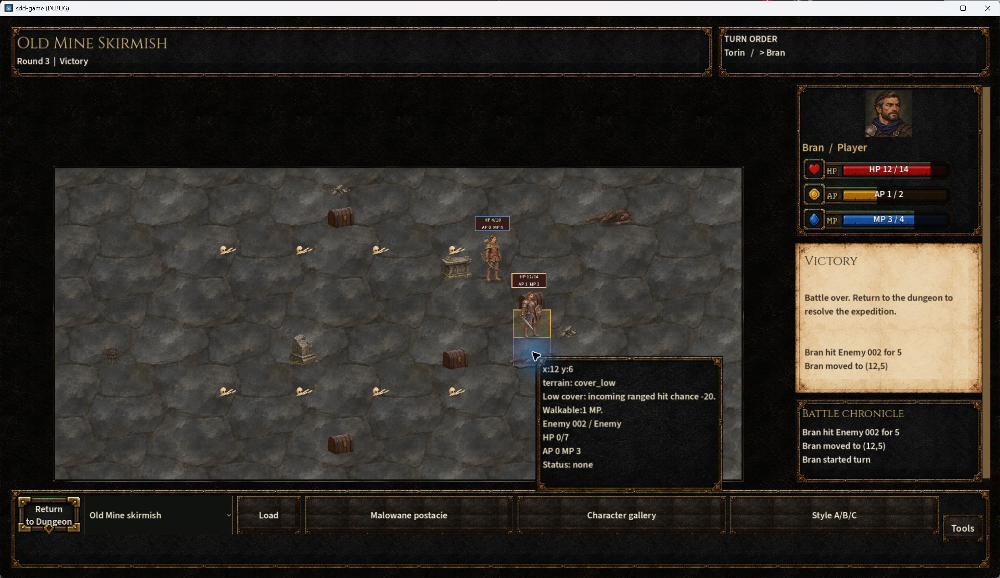
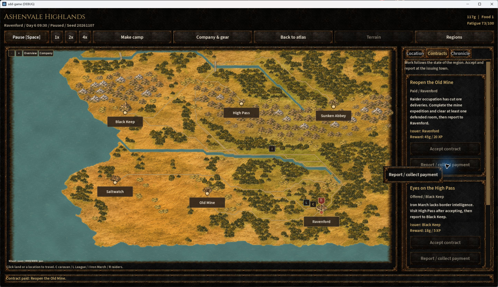
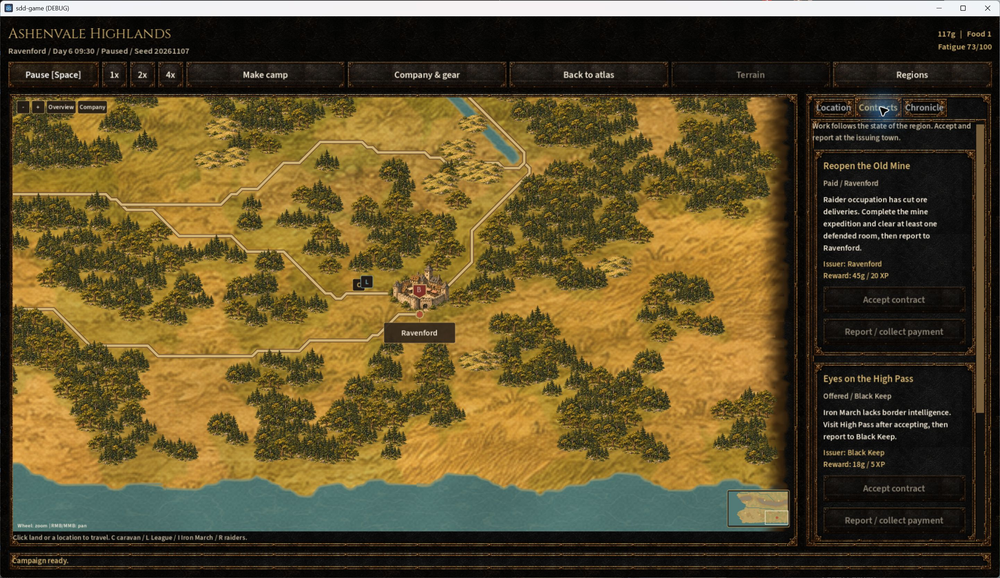

## Combat regressions

L87-01 PASS: both shots reject the blocked target without cost. Two independent
static-fixture runs use a normal3MP detour, then hit that same target with Aimed
(5damage/2AP) or basic (3damage/1AP). This is a resolver/HUD test; the legacy QA
fixture uses generic Bran artwork despite its bow loadout, not an art specimen.

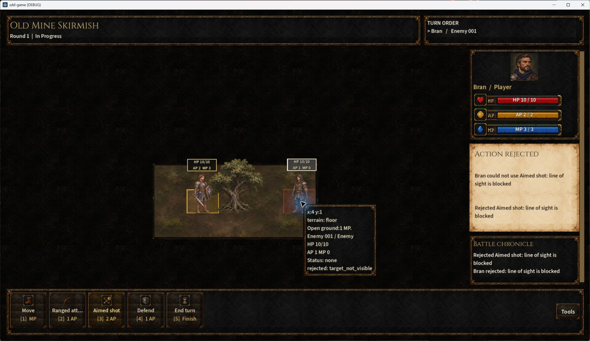
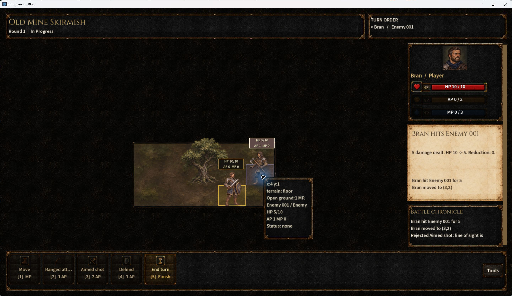

L88-01 PASS: a spear with AP0 and3MP left immediately passes without moving.
L89-01 PASS:1MP cannot buy a2MP step; affordable2MP highground and1MP floor
steps work normally. Static fixture evidence is not an ordinary victory claim.

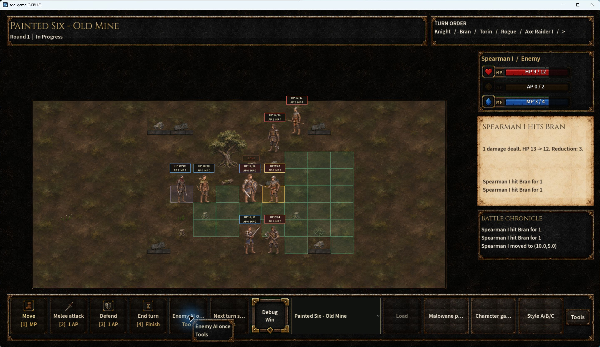
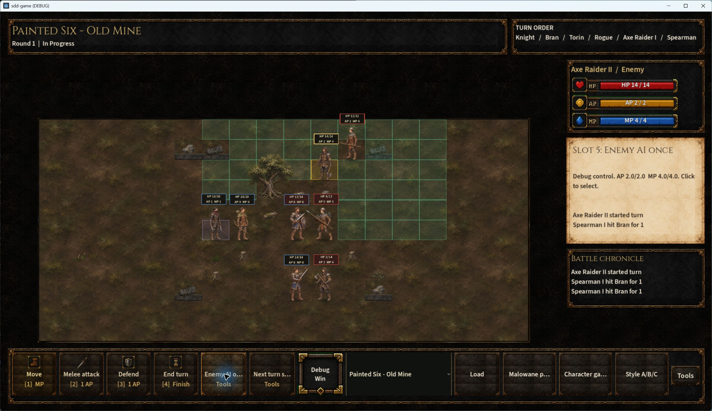
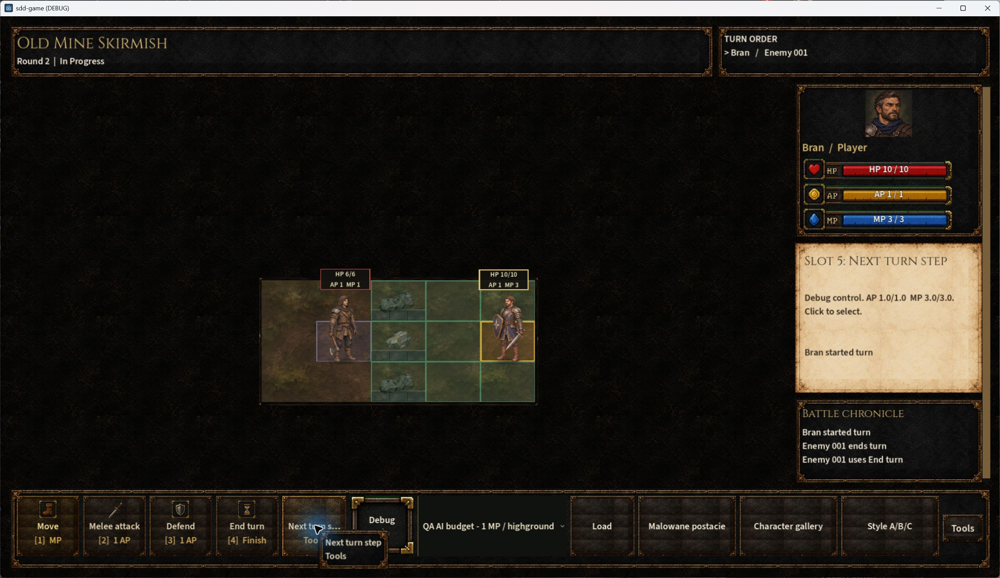
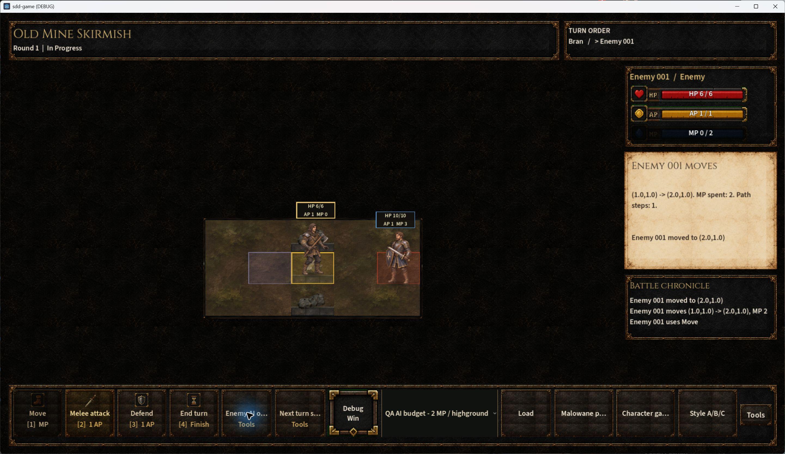
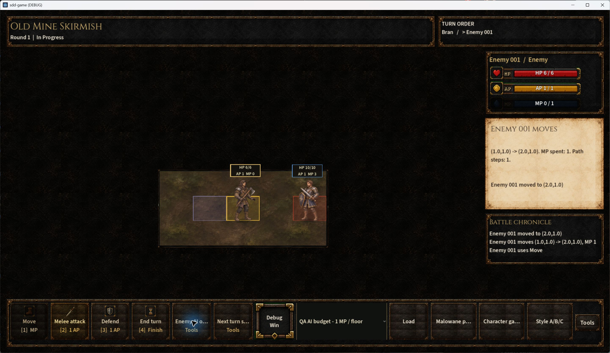

## Limits

Broader L77-01 delivery/recon/camping/raids cases remain open. User composition,
movement and prop approval is separate. One enemy turn was accidentally skipped
in the post-fix Painted Six replay: its victory capture is retained but excluded
from clean ordinary-policy victory evidence. The earlier L84-03 ordinary victory
remains in `../desktop-followup/`. A tentative earlier preview-damage discrepancy
needs isolated reproduction; the bow fixture and campaign previews matched.
