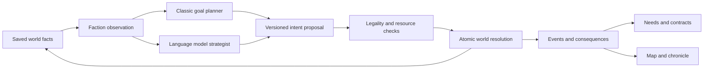

# Strategic world and interchangeable faction planners

Priority update2026-11-10: user now prioritizes complete autonomous world life
and permits simpler economics. Proposed [world024](024_autonomous_world_life.md)
and its product plan supersede this document's next-step emphasis on economic
refinement/live inference. Preserve implemented017..023 rules/saves until explicit
versioned changes. A classic actor/episode loop comes before provider selection;
this planning update changes no runtime.

Date:2026-11-09. Status: DESIGNED; isolated foundation implemented in
[world016](016_strategy_foundation.md), stage93, and classic simulation in
[world017](017_classic_strategy.md), stage94. Opt-in native terrain/company
integration is implemented in [world018](018_strategic_region.md), stage95,
with automated proof and deferred physical acceptance. The bounded strategist
adapter/offline proposal examples are implemented in [world019](019_model_strategist.md),
stage96. Live language-model inference remains unconfigured.
User-selected direction: a complete local classic mode, plus a language model
acting as faction strategist. This proposed owner governs the replacement
strategic layer after implementation. World010..014 remain authoritative for
the running pilot until an explicit opt-in versioned slice is implemented.
Acceptance: [slice016](slices/016_world_strategy.md). Product brief:
[world strategy plan](../../design/living-world/2026-11-09/WORLD_STRATEGY_PLAN.md).

## Shared authority and observable causality

Both modes consume faction observations and produce the same proposed intents.
Only the simulation validates and applies an intent. Neither planner can assign
gold, complete an expedition, sign another faction's consent, spawn an army,
rewrite geography or turn a predicted outcome into an accomplished fact.

Maintain existing15minute strategic ticks, weighted terrain and Large-region
physical scale. Menus/pause and current dungeon checkpoint time retain their
owners. No wall-clock catch-up while a save is closed. Planner/network latency
does not advance strategic time or seize the game loop.

Proposed cadences: movement on each tick, logistical dispatch on6hour boundaries,
economy/diplomatic execution on daily boundaries, strategic goal review weekly.
Long plans span7..21days, have a minimum3day commitment unless invalidated, and
contain measurable milestones and failure/alternative conditions. All values
are explicit prototype tuning, not changes to the current0.6second tick.

## Data and political entities

Use stable registries keyed by IDs; no fixed actor-array positions or required
three-town/two-faction counts. The first new fixture has four political factions,
six settlements, connected trade routes and a bounded pool of mobile parties.
River League, Iron March, Ravenford, Saltwatch and Black Keep keep their IDs and
identity. Two new factions/three additional towns belong to the new fixture or
new campaign generation, never a silent edit to an existing snapshot.

Store faction treasury, manpower, available/committed forces, stockpiles,
economic dependencies, strategic personality, plans, reports and reputation.
Initially use food, ore and timber plus treasury/manpower, with declared unit
scales; do not pretend current abstract `supply` is a conserved commodity.
The existing supply/security indicators become documented projections or retain
their old role until an explicit economic migration maps them.

Distinguish:

- **Company reputation:** the existing faction.relation meaning, bounded-100..100.
- **Inter-faction trust/grievance:** directional beliefs and past acts.
- **Diplomatic facts:** one canonical pair record for peace/war, signed treaties,
  ceasefire expiry and contested claims. A war is symmetric even if trust is not.
- **Trade dependency:** actual contracted resources, route access, capacity and
  recent delivery reliability; it is not the same as friendship.

One primary goal and up to two supporting goals per faction prevent contradictory
orders. Examples: restore ore access, secure a food corridor, contain a military
threat, protect a shrine or rebuild reserves. Goals can conflict without making
war inevitable. The company is not the default target of every faction.

An opening premise may configure dependencies, public agreements, disputes and
private ambitions using supported entity IDs and bounded resources. The first
release uses authored seeded premises; an optional later model-authored opening
must pass the same placement, route, fairness and budget validator and be saved
as canonical data before play. During play, faction planners respond to facts;
a global storyteller cannot invent an invasion or crisis to force a plot arc.

## Economy, travel and parties

Daily production/consumption uses explicit capacity and stock, with a ledger of
sources, sinks and transfers. A delivery removes goods from its source/reserved
stock and loads a real convoy. Arrival, interception or loss changes that cargo
once; purchasing or signing a trade agreement does not teleport goods.
Production is a declared source, not an arbitrary "AI bonus". Treasury payments
and escrow cannot be spent twice. Repair, recruitment and mobilization consume
configured resources and time; force cannot exceed available manpower/capacity.

Route selection uses world011/012/014, including forest/slopes, bridges, blocked
rivers/peaks and physical map scale. Diplomatic danger/permission can influence
route preference but never make an impassable cell walkable. Civilian and military
movement is visible and persistent. Goal changes replan from actual positions.

World-party clashes use a bounded seeded resolution model with explicit supply,
force and terrain inputs and casualty receipts. A language model cannot choose
the winner. Player tactical involvement must use a separately verified handoff
with actual party IDs and one-time return settlement; automatic world clashes
are not evidence that the player can already join them. Existing tactical and
road-combat rules remain unchanged in this design increment.

## Diplomatic actions and agreements

Initial operators: hold/rebuild, protect_route, dispatch_supply, propose_trade,
propose_nonaggression, propose_defensive_pact, withdraw_offer, mobilize_border,
declare_war, propose_ceasefire, accept_offer, reject_offer and fund_contract.
Each operator declares prerequisites, resource reservation, authority, duration
and exact effects. Missing routes, inaccessible targets, insufficient reserves
or incompatible agreements reject without partial mutation.

Trade/nonaggression/defensive treaties require compatible signed consent from
both parties. A proposal has stable terms, ID, validity window and a bounded
counteroffer policy. Do not set alliance=true in a single faction's response.
War requires a real strategic motive, a reachable objective, military/logistical
readiness and a valid policy for existing pacts. Valid motives derive from known
claims, trade disputes, treaty breaches or an explicit expansionist policy.
Breaking a pact has public trust consequences; it is never a free UI toggle.

A defensive pact may trigger a request for aid. The ally still needs forces and
routes or can dishonour it at a recorded cost. Alliances are not automatically
transitive. Ceasefires and trade suspensions are explicit facts, with expiry and
breach handling. Armies do not teleport when a war starts or ends.

No permanent growth of a global tension counter forces every campaign into war.
Exhaustion, mutual trade, stronger neighbours and unprofitable objectives can
support deterrence and peace. The first playable strategy slice has contested
corridors and border losses; full settlement conquest/elimination is a later
rule set, not a hidden prerequisite for useful diplomacy.

## Classic planner

Generate feasible goal/action candidates from the same observation used by AI
mode. Score expected economic/security benefit, ideology/claims, diplomacy,
readiness, cost, uncertainty and switching cost with configured utility curves.
Record component scores and reason codes. Deterministic seeded tie-breaking
must not consume combat rolls or depend on dictionary iteration/frame order.

Execute selected goals through small declared step/contingency templates. Keep
commitment/hysteresis so a faction does not alternate alliance/war every review.
Local executors handle routes, stock reservations and routine treaty replies
under the saved strategic policy. Hold/rebuild is always a legitimate candidate.
Weights may change by faction and actual history, not by secretly reading the
player's hidden inventory or scaling armies to their level.

## Language-model strategist

The model receives a bounded, timestamped **faction observation**, including its
own economy, commitments, known public diplomatic facts, reports with age and
confidence, accessible candidates, legal capabilities and recent outcomes. Other
factions' private plans and the company's hidden inventory are excluded. Each
faction is isolated; a global batch prompt must not leak the others' secrets.

The response proposes a primary goal, supporting preferences, ordered candidate
intents and bounded contingencies, a review horizon and short reason codes. The
model can combine a trade guarantee, alliance and later pressure into a longer
strategy. Its explanation is not an executable effect or evidence of success.
Do not request or display private chain-of-thought. Player text derives from
committed facts and public explanations, with deterministic fallback copy.

The protocol envelope contains:

- schema/policy versions, request_id, decision_id, faction_id and mode generation;
- observation hash, observation_tick, requested_review_tick and apply_by_tick;
- goal ID/type, supported target IDs, review horizon and commitment duration;
- at most3prioritized allowed intents, known candidate IDs and bounded parameters;
- at most2contingencies referencing explicit observable predicates;
- short reason codes, cited observed event IDs and a bounded public summary.

Reject unknown IDs, invented facts/events, unauthorized operators, invalid
quantities or any response that fails structural validation. Recheck current
world preconditions/resources at execution even for an earlier valid proposal.
A model response is data, never code, a scene path or arbitrary resource JSON.

Requests are asynchronous and budgeted. Proposed prototype cadence: staggered
weekly faction reviews;14day plan horizon; at most one extra request per faction
per strategic day after a material invalidating event; a global real-time rate /
token/cost ceiling. The default new campaign starts with valid classic plans,
so neither start nor movement waits for the model. Exact provider/timeouts/cost
ceilings are configuration decisions before live integration, not spent here.

Use a fixed apply deadline/review boundary. A missing, malformed, late, stale or
over-budget reply keeps the still-valid plan or uses a freshly validated classic
proposal. Coalesce obsolete pending requests; never catch up with a request
storm after unpausing or returning from an expedition. Offline play remains a
complete classic campaign; settings can indicate the active fallback plainly.

Persist accepted decisions before they can have effects. Replay uses the recorded
decision stream, not a new API call. A seed alone cannot promise identical LLM
responses. Provider retries and process restarts cannot apply a decision twice.
Pending/cached reply lifecycle belongs to the session boundary; an abandoned
process cannot later mutate a different campaign or mode generation.
Bounded narrative/report memory must not discard outstanding agreements or
idempotence guarantees. Canonical obligations and per-faction decision sequence
watermarks survive history pruning; old decisions remain rejected. Replay uses
a checkpoint plus its recorded subsequent decisions, with an explicit archive
policy if replay from campaign start is offered.

## Atomic ordering and simultaneous choices

At a decision boundary, construct observations from the same committed snapshot.
Resolve proposals through stable, documented phases: validate context, reserve
budgets, resolve bilateral consent/conflicts, execute movement/economic effects,
write receipts and publish facts/reports. Prevent two goals from spending the
same faction treasury/force twice. Rotate or seed contention tie-breaking so
alphabetical faction IDs do not always win. Signed agreement terms are identical
for both signatories or neither side commits. Failed writes roll back the whole
transition, including time, parties, stock, diplomacy, contracts and receipts.

## Contracts, sites and player agency

Contract candidates follow facts and causes: supply deficit, failed convoy,
contested passage, occupied adventure site, stale intelligence or reconstruction.
A faction must reserve a real contract budget; it cannot post unlimited rewards
while bankrupt. The contract pool is downstream of world strategy and needs.
Accepting freezes its terms and target context; later world changes do not
silently rewrite objectives or erase an earned right to payment.

Finite cause/episode IDs, target claims and cooldowns prevent repeated payment
for the same cleared camp or delivery receipt. New work requires a new actual
cause. Keep canonical Old Mine restoration permanent in existing saves.
Reoccupation of new sites needs a supported arriving force/new episode and
history, never a hidden daily respawn. Prefer several relevant opportunities
over flooding the player with duplicate map pins.

Initially connect existing delivery/scout/restoration capabilities. Recovery,
rescue/sabotage and conflicting-objective families need their own genuine dungeon
objectives and result proofs before advertising them as playable. No text-only
quest completion or invented loot. Explicitly record issuer, beneficiary, target,
cause, resource commitment, terms, outcome and report/payment receipts.

The player can observe politics without joining a faction. A relationship change
does not auto-accept a job or command the company. Public consequences and rumours
give actionable information; hostile politics must not silently strand a neutral
company with no reachable provision/return option in the starter region.

## Compatibility and integration prerequisites

Current living v1 hardcodes two factions, three settlements, four party IDs and
their order; global `intelligence` is not per-faction knowledge. Current contract
IDs are fixed and `world.location_id` is validated against the legacy atlas.
Managed `living_site` currently accepts only Old Mine. These are named migration
prerequisites, not implementation details that can be skipped by adding records.

Introduce a separately versioned strategy-world state/experimental campaign.
An explicit dispatcher keeps existing living v1 saves on world010 unchanged.
New simulation state uses stable registries, pair treaties, cause/event/decision
receipts, planner mode/version and bounded history. Immutable geography and its
checksum remain separate from mutable ownership, danger and dynamic-site overlays.
Do not insert unknown dynamic IDs into legacy world.location_id or relax its
validator globally; a strategy-mode location/site boundary must own those IDs.

If later migrating a pilot, preview an explicit copied conversion, preserve its
original bytes and all active/paid contracts, effects, equipment and receipts.
No conversion while a run/event is pending. Loading alone never writes or resets
a world; unsupported states remain blocked with their files preserved.

Mode switch occurs only at a paused safe boundary. It preserves wars, treaties,
resources, accepted contracts and applied decisions; invalidate pending requests
from the old mode generation. Toggling modes is not a treaty/stock/world reroll.
Keep simulator version, content version and recorded decision context in saves.

## Delivery gates

Implement in the order in the product plan: versioned model, classic simulation,
native travel/consequence slice, provider-neutral recorded-reply adapter, live
configured model, then comparison/balance. Existing L91/L77 physical acceptance
and new ordinary world play remain explicit promotion gates. This design adds
no runtime code, provider connection, new faction on the live map or permission
to take over the desktop. Planned tests are in slice016.

Follow-up97a adds a measured offline logistics/readiness prerequisite after the
user-requested Vast expansion, before configuring live inference. See world021 /
tooling006. Matched classic/authored fixtures diagnose the common executor; they
do not close96's live-provider configuration or97's real-model comparison gate.
